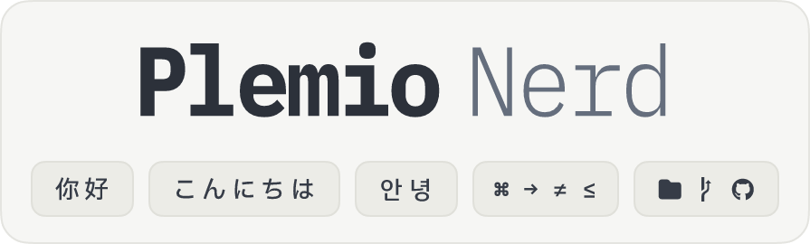
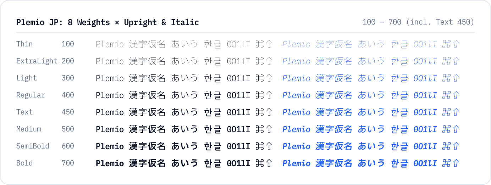
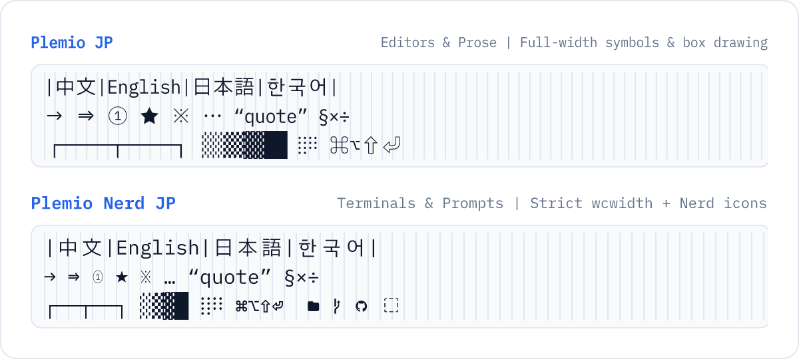
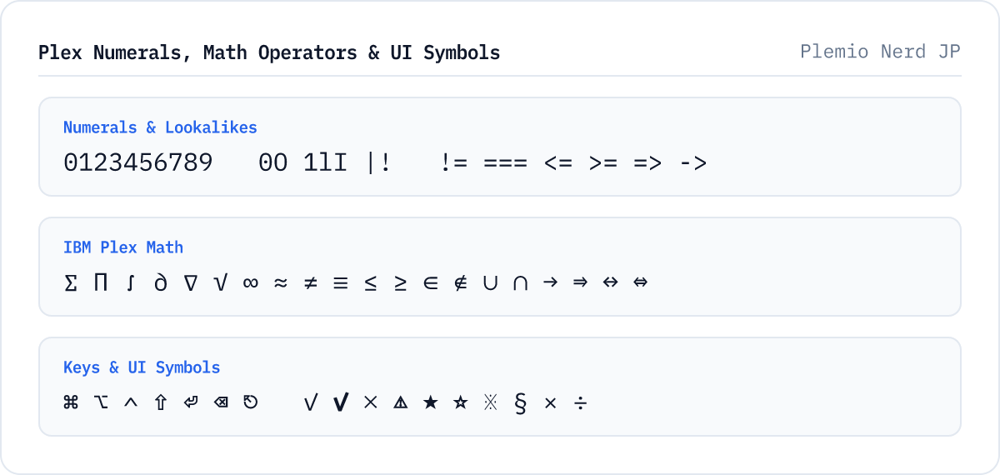

<div align="center">



[English](./README.md) | [简体中文](./README.zh-CN.md) | [繁體中文](./README.zh-TW.md) | [日本語](./README.ja.md) | [한국어](./README.ko.md)

[](./OFL.txt)
[](./LICENSE)

</div>

Plemio は、IBM Plex をベースに合成したターミナル、コードエディタ、技術文書向けの等幅プログラミングフォントです。日本語、中国語、韓国語（CJK）の文字と半角英数字を厳密に 2:1 の文字幅比で揃えているため、多言語が混在するコード、コメント、表でも列がきれいに並びます。

<p align="center">
  
</p>

## ✨ 特徴

### `1` 8 ウェイトとイタリック体

`Thin`（100）から `Bold`（700）までの 8 ウェイトを揃え、長時間の画面閲覧に向く IBM Plex 独自の `Text`（450）も含まれています。すべてのウェイトにイタリック体を用意しており、CJK グリフも IBM Plex Mono Italic と同じ角度で傾斜します。

<p align="center">
  
</p>

### `2` 用途に応じた 2 つのシリーズ

エディタとターミナルでは East Asian Ambiguous（曖昧幅）記号の扱いが異なるため、Plemio は 2 つのシリーズを提供しています。**Plemio** シリーズは欧文をわずかに細めに収めつつ和文句読点や矢印、罫線を全角幅に保ち、エディタや文書執筆に向きます。**Plemio Nerd** シリーズは IBM Plex Mono の字幅をそのまま保ち、ターミナルの `wcwidth` に合わせて記号の重なりやズレを防ぎながら Nerd Fonts アイコンを内蔵しています。

<p align="center">
  
</p>

### `3` ターミナル向け Nerd アイコンと記号類

プロンプトや TUI ツール向けに、**Plemio Nerd** は Nerd Fonts アイコンと継ぎ目のない Powerline セパレータを収録しています。隙間なくつながる罫線文字やシェードブロック、プログラム生成の点字パターン、全角スペース（`U+3000`）を判別できる破線マーカーも備えています。

<p align="center">
  
</p>

### `4` コーディングとターミナルに向けたベースラインと中央揃え調整

単純に複数フォントを合成すると、漢字や記号、アイコンが英数字のコードと縦方向でズレて見えがちです。Plemio は IBM Plex Mono の見分けやすい `0O` と `1lI` の造形を保ちつつ、開発でよく使う文字群ごとにベースラインと視覚的な中央位置を調整しています。

- **CJK と欧文の縦位置バランス**：日本語と中国語のグリフをわずかに縦補正し、漢字やかなの視覚中心を欧文に揃えています。ハングルは音節ブロックが中央に収まるよう元の高さを保ち、全角括弧には水平オフセットを加えて余白の偏りを抑えています。
- **数学軸に揃えた演算子**：`≠`、`≤`、`≥`、`→`、`⇒`、`∈`、`∑` などの記号は IBM Plex Math から取り込み、各ウェイトの線幅に合わせたうえで `=`、`+`、`-` と同じ数学軸に揃えています。
- **大文字高さの中央に揃えた UI 記号**：矢印や macOS の修飾キー記号（`⌘`、`⌥`、`⌃`、`⇧`、`⏎`）、チェックマーク、星印などは大文字高さの中央に合わせ、コード行の中で浮いたり沈んだりしないようにしています。
- **行ボックス基準のターミナル記号**：`Plemio Nerd` の Nerd Fonts アイコン、Powerline セパレータ、点字スピナー、全角スペース可視化マーカー（`U+3000`）は行ボックスの高さに合わせて中央配置しており、異なるターミナルエミュレータでも文字の並びになじみます。

<p align="center">
  
</p>

## 📦 ダウンロードとインストール

### Homebrew

macOS または Linux では [Homebrew](https://brew.sh/) からインストールできます（他の地域版を使う場合は `jp` を `sc`、`tc`、`kr` に置き換えてください）。

```bash
brew install --cask fang2hou/tap/font-plemio-jp
brew install --cask fang2hou/tap/font-plemio-nerd-jp

# 4 地域をまとめた TTC パッケージをインストールする場合
brew install --cask fang2hou/tap/font-plemio
brew install --cask fang2hou/tap/font-plemio-nerd
```

### 手動ダウンロード

下のリンクから必要なシリーズと地域の最新アーカイブを直接ダウンロードし、展開した `.ttf` ファイルをインストールしてください。4 つの地域版（`SC`、`TC`、`JP`、`KR`）は収録文字がすべて共通で、標準字形や句読点の位置だけが異なります。用途や好みの表記に合わせて 1 つ選べば十分です。

| 地域 | Plemio（エディタ向け） | Plemio Nerd（ターミナル向け） |
| :--- | :--- | :--- |
| 簡体字中国語（`SC`） | [Plemio-SC.zip](https://github.com/fang2hou/Plemio/releases/latest/download/Plemio-SC.zip) | [Plemio-Nerd-SC.zip](https://github.com/fang2hou/Plemio/releases/latest/download/Plemio-Nerd-SC.zip) |
| 繁体字中国語（`TC`） | [Plemio-TC.zip](https://github.com/fang2hou/Plemio/releases/latest/download/Plemio-TC.zip) | [Plemio-Nerd-TC.zip](https://github.com/fang2hou/Plemio/releases/latest/download/Plemio-Nerd-TC.zip) |
| 日本語（`JP`） | [Plemio-JP.zip](https://github.com/fang2hou/Plemio/releases/latest/download/Plemio-JP.zip) | [Plemio-Nerd-JP.zip](https://github.com/fang2hou/Plemio/releases/latest/download/Plemio-Nerd-JP.zip) |
| 韓国語（`KR`） | [Plemio-KR.zip](https://github.com/fang2hou/Plemio/releases/latest/download/Plemio-KR.zip) | [Plemio-Nerd-KR.zip](https://github.com/fang2hou/Plemio/releases/latest/download/Plemio-Nerd-KR.zip) |

複数地域をまとめた `.ttc` パッケージや過去バージョンは [Releases](https://github.com/fang2hou/Plemio/releases) ページで公開しています。

## 🚀 使い分けの目安

- **コードエディタと文書執筆**：`Plemio JP`（または `SC`、`TC`、`KR`）を選ぶと、引き締まった欧文リズムと全角の和文句読点が得られます。
- **ターミナルとシェルプロンプト**：`Plemio Nerd JP`（または `SC`、`TC`、`KR`）を選ぶと、Nerd Fonts アイコン、Powerline ステータスバー、全角スペースマーカーが記号の重なりなく表示されます。

<details>
<summary>xterm.js 系ターミナルでの行高調整</summary>

Plemio は IBM Plex Mono と同じ `1.3` の行高を採用しています。VS Code の内蔵ターミナルや Orca など `xterm.js` ベースのターミナルでは、フォントの行高にターミナル側の `lineHeight` 設定が掛け合わされます。フォント既定の行間を保つ場合は `1.0` を、縦の余白を広げて 2x ディスプレイの `14 px` 表示で上下の余白を均等に保つ場合は `1.335` を指定してください。

</details>

## 🔤 フォント構成

Plemio は複数の IBM Plex ファミリと補完用シンボルフォントを組み合わせて構成しています。

- **IBM Plex Mono**：欧文、数字、ギリシャ文字、キリル文字、基本記号、罫線文字、ブロック要素
- **IBM Plex Math**：各ウェイトの線幅に調整した数学演算子、矢印、技術記号
- **IBM Plex Sans SC / TC / JP / KR**：簡体字中国語、繁体字中国語、日本語（かなと漢字）、韓国語（ハングル）
- **Nerd Fonts**：`Plemio Nerd` シリーズ向けの開発者アイコンと Powerline セパレータ
- **Noto Sans Mono と JetBrains Mono**：残りの補助記号の補完

## 🛠️ ソースからのビルド

ソースからビルドするには macOS または Linux に [mise](https://mise.jdx.dev/) が必要です。ツールバージョンはすべて `mise.toml` に固定しています。TTC を生成する `mise run bundle` は、`pnpm dlx` でパッケージャを取得するためネットワーク接続が必要です。

```bash
mise install          # Python 3.12, uv, Node LTS, pnpm, prek, cocogitto, gitleaks を導入
mise run setup        # Python 依存パッケージと Git フックをインストール
mise run fetch        # 固定バージョンの元フォントを取得し sources.lock で検証
mise run build        # build/fonts に全 128 種の TTF をビルド
mise run verify-fonts # 文字幅、メタデータ、収録範囲の整合性を検証
mise run bundle       # 地域別 TTF を build/ttc 以下の TTC にパッケージング
```

パラメータ調整やプレビュー画像の生成手順は [DEVELOPMENT.md](./DEVELOPMENT.md) を、パイプラインの設計制約は [ARCHITECTURE.md](./ARCHITECTURE.md) を参照してください。

## 🤝 コントリビューション

Issue の報告や Pull Request を歓迎します。提出前に [CONTRIBUTING.md](./CONTRIBUTING.md) でブランチ運用、Conventional Commits の規約、視覚変更時の確認手順をご確認ください。

## 🙏 謝辞

- **PlemoCJK と PlemolJP**：2 シリーズ構成と 4 地域 CJK 対応の着想源となりました（[PlemoCJK](https://github.com/nexustar/PlemoCJK)、[PlemolJP](https://github.com/yuru7/PlemolJP)。Plemio は純 Python パイプラインで一から合成しており、PlemolJP のフォントデータは一切含んでいません）。
- **IBM Plex**：中核となる Mono、Math、Sans SC / TC / JP / KR を提供しています（[IBM/plex](https://github.com/IBM/plex)）。
- **Nerd Fonts、Noto Sans Mono、JetBrains Mono**：ターミナルアイコンと補完記号を提供しています（[nerd-fonts](https://github.com/ryanoasis/nerd-fonts)、[Noto](https://github.com/notofonts/latin-greek-cyrillic)、[JetBrainsMono](https://github.com/JetBrains/JetBrainsMono)）。
- **fontTools、skia-pathops、ttfautohint、otb-ttc-bundle**：グリフ合成、輪郭の太さ調整、欧文ヒンティングの再構築、TTC パッケージングを支えています。

## 📄 ライセンス

- フォントファイル：[OFL-1.1](./OFL.txt)（IBM Plex は予約フォント名「Plex」を定めており、派生フォントでは使用できません。Nerd Fonts アイコンは MIT ライセンスです）
- ビルドコード：[MIT](./LICENSE)
