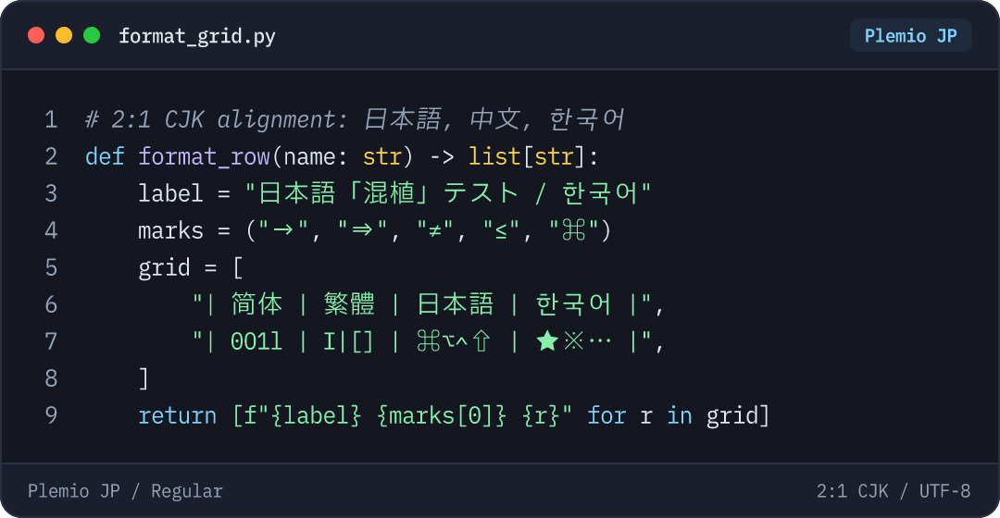
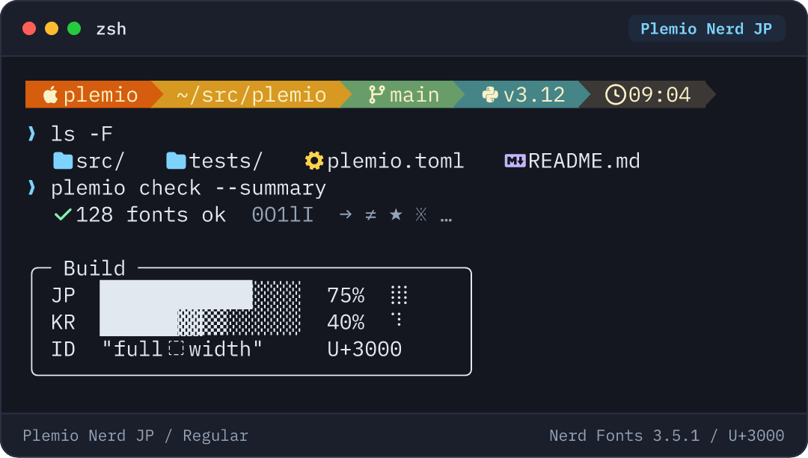

<div align="center">


[English](./README.md) | [简体中文](./README.zh-CN.md) | [繁體中文](./README.zh-TW.md) | [日本語](./README.ja.md) | [한국어](./README.ko.md)

[](./OFL.txt)
[](./LICENSE)

</div>

Plemio は、IBM Plex をベースにしたターミナル、コードエディタ、技術文書向けの等幅プログラミングフォントです。日本語、中国語、韓国語（CJK）の文字幅は半角英数字のちょうど 2 倍なので、多言語が混在するコード、コメント、表でも列がそろいます。

<p align="center">
  
</p>

## ✨ 特徴

### `1` 8 ウェイトとイタリック体

`Thin`（100）から `Bold`（700）までの 8 ウェイトで、IBM Plex の `Text`（450）も含みます。すべてのウェイトにイタリック体があり、CJK グリフも IBM Plex Mono Italic と同じ角度で傾きます。

<p align="center">
  
</p>

### `2` エディタ向けとターミナル向けの 2 シリーズ

- **Plemio**（エディタ・文書向け）：欧文をやや細めに収め、和文句読点、矢印、罫線は全角幅です。
- **Plemio Nerd**（ターミナル向け）：IBM Plex Mono の字幅をそのまま使い、曖昧幅の記号はターミナルに合わせて半角にしています。Nerd Fonts アイコンも収録しています。

<p align="center">
  
</p>

### `3` ターミナル向けのアイコンと記号

**Plemio Nerd** は Nerd Fonts アイコン、継ぎ目のない Powerline セパレータ、隙間のない罫線、点字パターンを収録し、全角スペース（`U+3000`）は破線で表示します。

<p align="center">
  
</p>

### `4` 縦位置をそろえた記号

IBM Plex Mono の見分けやすい `0O` と `1lI` はそのままに、ほかのグリフは欧文のコードと高さがそろうよう配置しています。

- CJK 文字は欧文の視覚的な中心に合わせています。
- `≠`、`≤`、`→`、`∑` などの数学記号は IBM Plex Math から取り込み、`=` や `+` と同じ軸にそろえています。
- 矢印、macOS の修飾キー記号（`⌘`、`⌥`、`⇧`）、チェックマークは大文字の高さの中央に合わせています。

<p align="center">
  
</p>

## 📦 ダウンロードとインストール

### Homebrew

macOS または Linux では [Homebrew](https://brew.sh/) からインストールできます（他の地域版を使う場合は `jp` を `sc`、`tc`、`kr` に置き換えてください）。

```bash
brew install --cask fang2hou/tap/font-plemio-jp
brew install --cask fang2hou/tap/font-plemio-nerd-jp

# 4 地域をまとめた TTC パッケージをインストールする場合
brew install --cask fang2hou/tap/font-plemio
brew install --cask fang2hou/tap/font-plemio-nerd
```

### 手動ダウンロード

下のアーカイブをダウンロードして展開し、`.ttf` ファイルをインストールしてください。4 つの地域版は収録文字が共通で、地域ごとの字形だけが異なるため、1 つ選べば十分です。

| 地域 | Plemio（エディタ向け） | Plemio Nerd（ターミナル向け） |
| :--- | :--- | :--- |
| 簡体字中国語（`SC`） | [Plemio-SC.zip](https://github.com/fang2hou/Plemio/releases/latest/download/Plemio-SC.zip) | [Plemio-Nerd-SC.zip](https://github.com/fang2hou/Plemio/releases/latest/download/Plemio-Nerd-SC.zip) |
| 繁体字中国語（`TC`） | [Plemio-TC.zip](https://github.com/fang2hou/Plemio/releases/latest/download/Plemio-TC.zip) | [Plemio-Nerd-TC.zip](https://github.com/fang2hou/Plemio/releases/latest/download/Plemio-Nerd-TC.zip) |
| 日本語（`JP`） | [Plemio-JP.zip](https://github.com/fang2hou/Plemio/releases/latest/download/Plemio-JP.zip) | [Plemio-Nerd-JP.zip](https://github.com/fang2hou/Plemio/releases/latest/download/Plemio-Nerd-JP.zip) |
| 韓国語（`KR`） | [Plemio-KR.zip](https://github.com/fang2hou/Plemio/releases/latest/download/Plemio-KR.zip) | [Plemio-Nerd-KR.zip](https://github.com/fang2hou/Plemio/releases/latest/download/Plemio-Nerd-KR.zip) |

`.ttc` パッケージや過去のバージョンは [Releases](https://github.com/fang2hou/Plemio/releases) ページにあります。

## 🔤 フォント構成

- **IBM Plex Mono**：欧文、ギリシャ文字、キリル文字、罫線
- **IBM Plex Math**：数学記号と矢印
- **IBM Plex Sans SC / TC / JP / KR**：CJK 文字
- **Nerd Fonts**：`Plemio Nerd` のアイコン
- **Noto Sans Mono と JetBrains Mono**：その他の記号

## 🛠️ ソースからのビルド

macOS または Linux に [mise](https://mise.jdx.dev/) が必要です。

```bash
mise install          # 固定バージョンのツールを導入
mise run setup        # 依存パッケージと Git フックをインストール
mise run fetch        # 元フォントを取得
mise run build        # build/fonts に全フォントをビルド
mise run verify-fonts # ビルドしたフォントを検証
mise run bundle       # build/ttc に TTC をパッケージング
```

詳しくは [DEVELOPMENT.md](./DEVELOPMENT.md) と [ARCHITECTURE.md](./ARCHITECTURE.md) を参照してください。

## 🤝 コントリビューション

Issue や Pull Request を歓迎します。提出前に [CONTRIBUTING.md](./CONTRIBUTING.md) をご確認ください。

## 🙏 謝辞

- [PlemoCJK](https://github.com/nexustar/PlemoCJK)、[PlemolJP](https://github.com/yuru7/PlemolJP)
- [IBM Plex](https://github.com/IBM/plex)
- [Nerd Fonts](https://github.com/ryanoasis/nerd-fonts)、[Noto](https://github.com/notofonts/latin-greek-cyrillic)、[JetBrains Mono](https://github.com/JetBrains/JetBrainsMono)

## 📄 ライセンス

- フォントファイル：[OFL-1.1](./OFL.txt)（Nerd Fonts アイコンは MIT ライセンス）
- ビルドコード：[MIT](./LICENSE)
