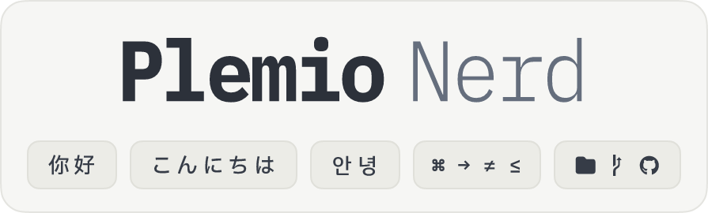
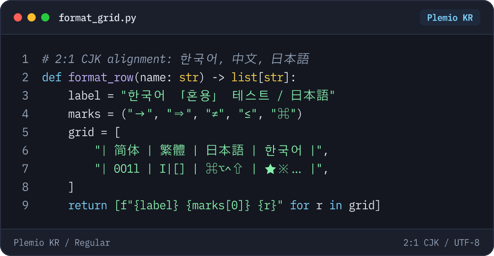
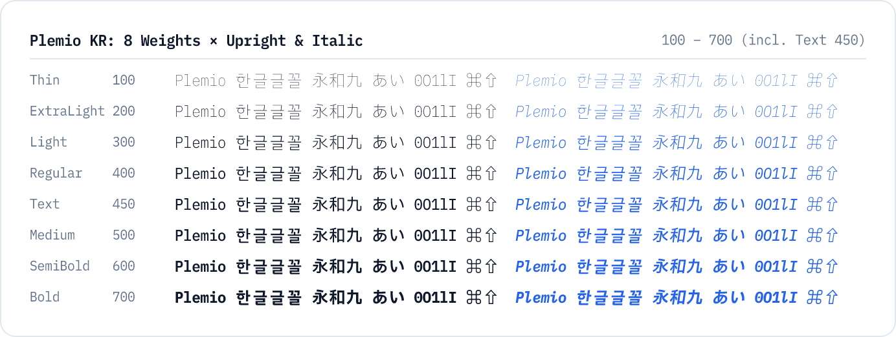
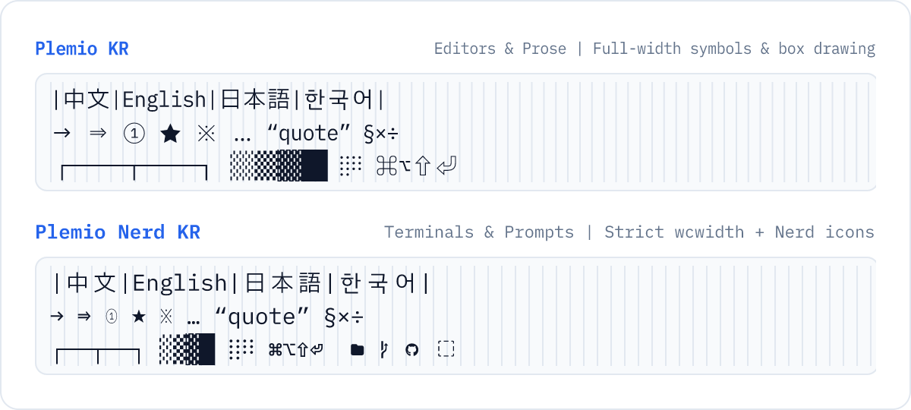

<div align="center">



[English](./README.md) | [简体中文](./README.zh-CN.md) | [繁體中文](./README.zh-TW.md) | [日本語](./README.ja.md) | [한국어](./README.ko.md)

[](./OFL.txt)
[](./LICENSE)

</div>

Plemio는 IBM Plex를 기반으로 한 터미널, 코드 에디터, 기술 문서용 고정폭 프로그래밍 폰트입니다. 한중일(CJK) 문자의 너비가 영문자의 정확히 두 배이므로 여러 언어가 섞인 코드, 주석, 표도 가지런히 정렬됩니다.

<p align="center">
  
</p>

## ✨ 특징

### `1` 8가지 굵기와 이탤릭

`Thin`(100)부터 `Bold`(700)까지 8가지 굵기를 제공하며 IBM Plex의 `Text`(450)도 포함합니다. 모든 굵기에 이탤릭이 있고, CJK 글리프도 IBM Plex Mono Italic과 같은 각도로 기울어집니다.

<p align="center">
  
</p>

### `2` 에디터용과 터미널용 두 시리즈

- **Plemio** (에디터·문서용): 영문 폭을 살짝 좁히고 CJK 문장부호, 화살표, 괘선 문자는 전각으로 유지합니다.
- **Plemio Nerd** (터미널용): IBM Plex Mono의 원래 폭을 그대로 쓰고, 모호한 너비 기호는 터미널에 맞춰 반각으로 처리하며 Nerd Fonts 아이콘을 내장합니다.

<p align="center">
  
</p>

### `3` 터미널용 아이콘과 기호

**Plemio Nerd**는 Nerd Fonts 아이콘, 이음새 없는 Powerline 구분자, 끊김 없는 괘선 문자, 점자 패턴을 담고 있으며 전각 공백(`U+3000`)은 점선으로 표시합니다.

<p align="center">
  
</p>

### `4` 세로 위치를 맞춘 기호

IBM Plex Mono의 구분하기 쉬운 `0O`, `1lI`는 그대로 두고, 나머지 글리프는 영문 코드와 높이가 맞도록 배치했습니다.

- CJK 문자는 영문의 시각적 중심에 맞춥니다.
- `≠`, `≤`, `→`, `∑` 등의 수학 기호는 IBM Plex Math에서 가져와 `=`, `+`와 같은 축에 정렬합니다.
- 화살표, macOS 키 기호(`⌘`, `⌥`, `⇧`), 체크 표시는 대문자 높이의 중앙에 맞춥니다.

<p align="center">
  
</p>

## 📦 다운로드 및 설치

### Homebrew

macOS 또는 Linux에서는 [Homebrew](https://brew.sh/)로 바로 설치할 수 있습니다(다른 지역 버전은 `kr` 대신 `sc`, `tc`, `jp`를 지정하세요).

```bash
brew install --cask fang2hou/tap/font-plemio-kr
brew install --cask fang2hou/tap/font-plemio-nerd-kr

# 네 지역이 모두 포함된 TTC 컬렉션 설치
brew install --cask fang2hou/tap/font-plemio
brew install --cask fang2hou/tap/font-plemio-nerd
```

### 직접 다운로드

아래 압축 파일을 내려받아 풀고 `.ttf` 파일을 설치하세요. 네 지역 버전은 지원 문자가 같고 지역별 자형만 다르므로 하나만 고르면 됩니다.

| 지역 | Plemio (에디터) | Plemio Nerd (터미널) |
| :--- | :--- | :--- |
| 중국어 간체 (`SC`) | [Plemio-SC.zip](https://github.com/fang2hou/Plemio/releases/latest/download/Plemio-SC.zip) | [Plemio-Nerd-SC.zip](https://github.com/fang2hou/Plemio/releases/latest/download/Plemio-Nerd-SC.zip) |
| 중국어 번체 (`TC`) | [Plemio-TC.zip](https://github.com/fang2hou/Plemio/releases/latest/download/Plemio-TC.zip) | [Plemio-Nerd-TC.zip](https://github.com/fang2hou/Plemio/releases/latest/download/Plemio-Nerd-TC.zip) |
| 일본어 (`JP`) | [Plemio-JP.zip](https://github.com/fang2hou/Plemio/releases/latest/download/Plemio-JP.zip) | [Plemio-Nerd-JP.zip](https://github.com/fang2hou/Plemio/releases/latest/download/Plemio-Nerd-JP.zip) |
| 한국어 (`KR`) | [Plemio-KR.zip](https://github.com/fang2hou/Plemio/releases/latest/download/Plemio-KR.zip) | [Plemio-Nerd-KR.zip](https://github.com/fang2hou/Plemio/releases/latest/download/Plemio-Nerd-KR.zip) |

`.ttc` 패키지와 이전 버전은 [Releases](https://github.com/fang2hou/Plemio/releases) 페이지에 있습니다.

## 🔤 구성 폰트

- **IBM Plex Mono**: 영문, 그리스 문자, 키릴 문자, 괘선 문자
- **IBM Plex Math**: 수학 기호와 화살표
- **IBM Plex Sans SC / TC / JP / KR**: CJK 문자
- **Nerd Fonts**: `Plemio Nerd`의 아이콘
- **Noto Sans Mono 및 JetBrains Mono**: 나머지 기호

## 🛠️ 로컬 빌드

macOS 또는 Linux에 [mise](https://mise.jdx.dev/)가 필요합니다.

```bash
mise install          # 고정 버전 도구 설치
mise run setup        # 의존성과 Git 훅 설치
mise run fetch        # 원본 폰트 다운로드
mise run build        # build/fonts에 전체 폰트 빌드
mise run verify-fonts # 빌드한 폰트 검증
mise run bundle       # build/ttc에 TTC 패키징
```

자세한 내용은 [DEVELOPMENT.md](./DEVELOPMENT.md)와 [ARCHITECTURE.md](./ARCHITECTURE.md)를 참고하세요.

## 🤝 기여하기

이슈와 Pull Request를 환영합니다. 제출 전에 [CONTRIBUTING.md](./CONTRIBUTING.md)를 확인해 주세요.

## 🙏 감사의 글

- [PlemoCJK](https://github.com/nexustar/PlemoCJK), [PlemolJP](https://github.com/yuru7/PlemolJP)
- [IBM Plex](https://github.com/IBM/plex)
- [Nerd Fonts](https://github.com/ryanoasis/nerd-fonts), [Noto](https://github.com/notofonts/latin-greek-cyrillic), [JetBrains Mono](https://github.com/JetBrains/JetBrainsMono)

## 📄 라이선스

- 폰트 파일: [OFL-1.1](./OFL.txt) (Nerd Fonts 아이콘은 MIT 라이선스)
- 빌드 코드: [MIT](./LICENSE)
