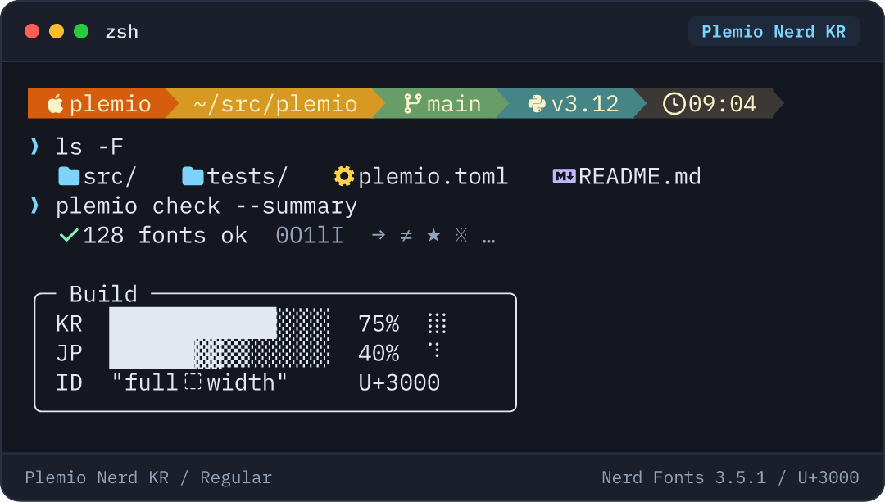
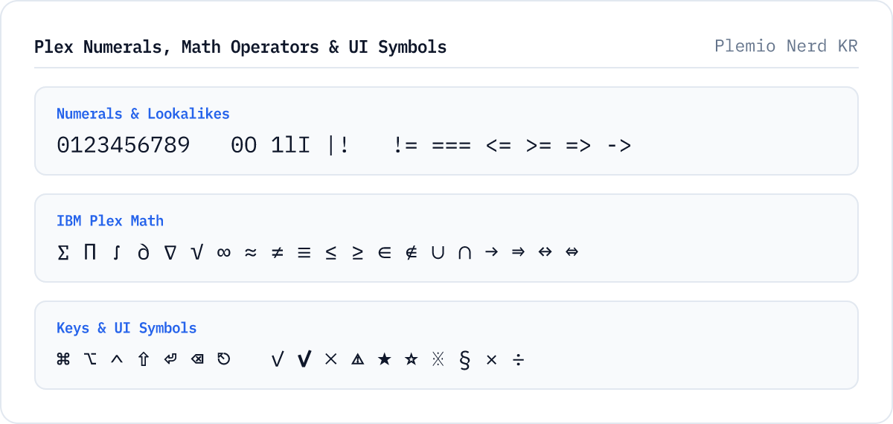

<div align="center">


[English](./README.md) | [简体中文](./README.zh-CN.md) | [繁體中文](./README.zh-TW.md) | [日本語](./README.ja.md) | [한국어](./README.ko.md)

[](./OFL.txt)
[](./LICENSE)

</div>

Plemio는 IBM Plex를 기반으로 제작한 터미널, 코드 에디터, 기술 문서용 고정폭(Monospace) 프로그래밍 폰트입니다. 한중일(CJK) 문자와 영문자의 너비 비율을 2:1로 엄격하게 맞추어 코드, 주석, 표가 섞여 있어도 줄이 깔끔하게 정렬됩니다.

<p align="center">
  
</p>

## ✨ 특징

### `1` 8가지 굵기와 전체 이탤릭 지원

`Thin`(100)부터 `Bold`(700)까지 8가지 굵기를 제공하며, 장시간 화면 가독성에 유리한 IBM Plex 고유의 `Text`(450) 굵기도 포함합니다. 모든 굵기에 이탤릭이 짝을 이루며, CJK 글리프 역시 IBM Plex Mono Italic과 같은 각도로 기울어집니다.

<p align="center">
  
</p>

### `2` 사용 환경에 맞춘 2가지 시리즈

에디터와 터미널은 모호한 너비(Ambiguous Width) 기호를 처리하는 방식이 다르므로 Plemio는 두 가지 시리즈를 제공합니다. **Plemio** 시리즈는 영문 폭을 살짝 좁히고 CJK 문장부호, 화살표, 괘선 문자를 전각으로 유지해 에디터와 문서 작성에 적합합니다. **Plemio Nerd** 시리즈는 IBM Plex Mono를 원형 그대로 유지하고 터미널의 `wcwidth` 규칙을 엄격히 따라 기호가 겹치거나 밀리지 않으며, Nerd Fonts 아이콘을 함께 내장합니다.

<p align="center">
  
</p>

### `3` 터미널을 위한 Nerd 아이콘과 특수 기호

터미널 프롬프트와 TUI 도구를 위해 **Plemio Nerd**는 Nerd Fonts 아이콘과 이음새 없는 Powerline 구분자를 내장했습니다. 끊김 없이 이어지는 괘선 문자와 진행률 블록, 코드로 생성한 점자 패턴, 그리고 눈으로 구분할 수 있는 전각 공백(`U+3000`) 점선 표시를 제공합니다.

<p align="center">
  
</p>

### `4` 코딩과 터미널에 맞춘 기준선 및 시각적 중앙 정렬

여러 폰트를 단순 병합하면 한글, 한자, 기호, 아이콘이 영문 코드와 세로 중심선이 어긋나기 쉽습니다. Plemio는 IBM Plex Mono의 구분이 명확한 `0O`, `1lI` 형태를 유지하면서 개발자가 자주 쓰는 문자군마다 기준선과 시각적 중심을 세밀하게 보정했습니다.

- **한중일 문자와 영문의 세로 균형**: 중국어와 일본어 글리프의 세로 위치를 미세 조정해 영문과 시각 중심을 맞추고, 한글은 음절 블록이 중심을 유지하도록 원래 높이를 그대로 살렸습니다. 전각 괄호에는 수평 오프셋을 적용해 불필요한 여백을 줄였습니다.
- **수학 축에 맞춘 연산자**: `≠`, `≤`, `≥`, `→`, `⇒`, `∈`, `∑` 등의 기호는 IBM Plex Math에서 가져와 각 굵기에 맞게 획 두께를 조절하고 `=`, `+`, `-`와 같은 수학 축에 정렬했습니다.
- **대문자 높이 중앙에 맞춘 UI 기호**: 화살표, macOS 키 기호(`⌘`, `⌥`, `⌃`, `⇧`, `⏎`), 체크 표시, 별표 등의 기호는 대문자 높이의 중앙에 맞추어 코드 줄 안에서 뜨거나 처지지 않습니다.
- **줄 높이 기준의 터미널 기호**: `Plemio Nerd`의 Nerd Fonts 아이콘, Powerline 구분자, 점자 스피너, 전각 공백 표시(`U+3000`)는 줄 높이(line box)를 기준으로 중앙 배치해 다양한 터미널 에뮬레이터에서 텍스트와 자연스럽게 어우러집니다.

<p align="center">
  
</p>

## 📦 다운로드 및 설치

### Homebrew

macOS 또는 Linux에서는 [Homebrew](https://brew.sh/)로 바로 설치할 수 있습니다(다른 지역 버전은 `kr` 대신 `sc`, `tc`, `jp`를 지정하세요).

```bash
brew install --cask fang2hou/tap/font-plemio-kr
brew install --cask fang2hou/tap/font-plemio-nerd-kr

# 네 지역이 모두 포함된 TTC 컬렉션 설치
brew install --cask fang2hou/tap/font-plemio
brew install --cask fang2hou/tap/font-plemio-nerd
```

### 직접 다운로드

아래 표에서 원하는 시리즈와 지역 버전의 링크를 클릭해 최신 배포 압축 파일을 바로 내려받은 뒤, 압축을 풀고 `.ttf` 파일을 설치하세요. 네 지역 버전(`SC`, `TC`, `JP`, `KR`)은 지원하는 문자 범위가 모두 같으며 지역 표준 자형과 문장부호 위치만 다르므로 사용 습관에 맞는 하나를 선택하면 됩니다.

| 지역 | Plemio (에디터) | Plemio Nerd (터미널) |
| :--- | :--- | :--- |
| 중국어 간체 (`SC`) | [Plemio-SC.zip](https://github.com/fang2hou/Plemio/releases/latest/download/Plemio-SC.zip) | [Plemio-Nerd-SC.zip](https://github.com/fang2hou/Plemio/releases/latest/download/Plemio-Nerd-SC.zip) |
| 중국어 번체 (`TC`) | [Plemio-TC.zip](https://github.com/fang2hou/Plemio/releases/latest/download/Plemio-TC.zip) | [Plemio-Nerd-TC.zip](https://github.com/fang2hou/Plemio/releases/latest/download/Plemio-Nerd-TC.zip) |
| 일본어 (`JP`) | [Plemio-JP.zip](https://github.com/fang2hou/Plemio/releases/latest/download/Plemio-JP.zip) | [Plemio-Nerd-JP.zip](https://github.com/fang2hou/Plemio/releases/latest/download/Plemio-Nerd-JP.zip) |
| 한국어 (`KR`) | [Plemio-KR.zip](https://github.com/fang2hou/Plemio/releases/latest/download/Plemio-KR.zip) | [Plemio-Nerd-KR.zip](https://github.com/fang2hou/Plemio/releases/latest/download/Plemio-Nerd-KR.zip) |

다지역 `.ttc` 통합 패키지와 이전 버전은 [Releases](https://github.com/fang2hou/Plemio/releases) 페이지에서 받을 수 있습니다.

## 🚀 사용 가이드

- **코드 에디터와 문서 작성**: `Plemio KR`(또는 `SC`, `TC`, `JP`)을 선택하면 단정한 영문 리듬과 전각 CJK 문장부호를 함께 사용할 수 있습니다.
- **터미널과 셸 프롬프트**: `Plemio Nerd KR`(또는 `SC`, `TC`, `JP`)을 선택하면 Nerd Fonts 아이콘, Powerline 상태 표시줄, 전각 공백 표시가 기호 겹침 없이 출력됩니다.

<details>
<summary>xterm.js 기반 터미널에서 줄 높이 조정하기</summary>

Plemio는 IBM Plex Mono의 `1.3` 줄 높이를 그대로 유지합니다. VS Code 내장 터미널이나 Orca처럼 `xterm.js`를 쓰는 터미널은 폰트 줄 높이에 자체 `lineHeight` 값을 곱해 렌더링합니다. 폰트 기본 줄 간격을 유지하려면 `1.0`을, 세로 여백을 넓혀 2x 디스플레이 `14 px` 환경에서 위아래 여백 균형을 맞추려면 `1.335`를 설정하세요.

</details>

## 🔤 구성 폰트

Plemio는 여러 IBM Plex 패밀리와 보조 기호 폰트를 조합해 구성합니다.

- **IBM Plex Mono**: 영문, 숫자, 그리스 문자, 키릴 문자, 기본 문장부호, 괘선 문자, 블록 요소
- **IBM Plex Math**: 각 굵기에 맞춰 획 두께를 조정한 수학 연산자, 화살표, 기술 기호
- **IBM Plex Sans SC / TC / JP / KR**: 중국어 간체, 중국어 번체, 일본어(가나 및 한자), 한국어(한글)
- **Nerd Fonts**: `Plemio Nerd` 시리즈용 개발자 아이콘과 Powerline 구분자
- **Noto Sans Mono 및 JetBrains Mono**: 나머지 보조 기호 보완

## 🛠️ 로컬 빌드

소스에서 직접 빌드하려면 macOS 또는 Linux에 [mise](https://mise.jdx.dev/)가 설치되어 있어야 합니다. 모든 도구 버전은 `mise.toml`에 고정되어 있으며, TTC를 묶는 `mise run bundle` 실행 시 `pnpm dlx`로 패키징 도구를 내려받기 위해 네트워크 연결이 필요합니다.

```bash
mise install          # Python 3.12, uv, Node LTS, pnpm, prek, cocogitto, gitleaks 설치
mise run setup        # Python 의존성과 Git 훅 설치
mise run fetch        # 고정 버전 원본 폰트 다운로드 및 sources.lock 검증
mise run build        # build/fonts에 전체 128개 TTF 빌드
mise run verify-fonts # 문자 폭, 메타데이터, 코드포인트 커버리지 검증
mise run bundle       # 지역별 TTF를 build/ttc 아래 TTC 컬렉션으로 패키징
```

파라미터 튜닝과 프리뷰 이미지 생성 방법은 [DEVELOPMENT.md](./DEVELOPMENT.md)에서, 파이프라인 불변 조건은 [ARCHITECTURE.md](./ARCHITECTURE.md)에서 확인할 수 있습니다.

## 🤝 기여하기

이슈 제보와 Pull Request를 환영합니다. 제출하기 전에 [CONTRIBUTING.md](./CONTRIBUTING.md)에서 브랜치 규칙, Conventional Commits 가이드, 시각적 변경 사항의 비교 기준을 확인해 주세요.

## 🙏 감사의 글

- **PlemoCJK와 PlemolJP**: 두 시리즈 구성과 4개 지역 CJK 지원의 설계 영감을 주었습니다([PlemoCJK](https://github.com/nexustar/PlemoCJK), [PlemolJP](https://github.com/yuru7/PlemolJP). Plemio는 순수 Python 파이프라인으로 처음부터 합성하며 PlemolJP 폰트 데이터는 전혀 포함하지 않습니다).
- **IBM Plex**: 핵심이 되는 Mono, Math, Sans SC / TC / JP / KR 폰트 패밀리를 제공합니다([IBM/plex](https://github.com/IBM/plex)).
- **Nerd Fonts, Noto Sans Mono, JetBrains Mono**: 터미널 아이콘과 보완 기호를 제공합니다([nerd-fonts](https://github.com/ryanoasis/nerd-fonts), [Noto](https://github.com/notofonts/latin-greek-cyrillic), [JetBrainsMono](https://github.com/JetBrains/JetBrainsMono)).
- **fontTools, skia-pathops, ttfautohint, otb-ttc-bundle**: 글리프 합성, 외곽선 두께 조정, 영문 힌팅 재구성, TTC 패키징을 지원합니다.

## 📄 라이선스

- 폰트 파일: [OFL-1.1](./OFL.txt) (IBM Plex는 예약 폰트 이름 "Plex"를 지정하고 있어 파생 폰트에 사용할 수 없으며, Nerd Fonts 아이콘은 MIT 라이선스를 따릅니다)
- 빌드 코드: [MIT](./LICENSE)
