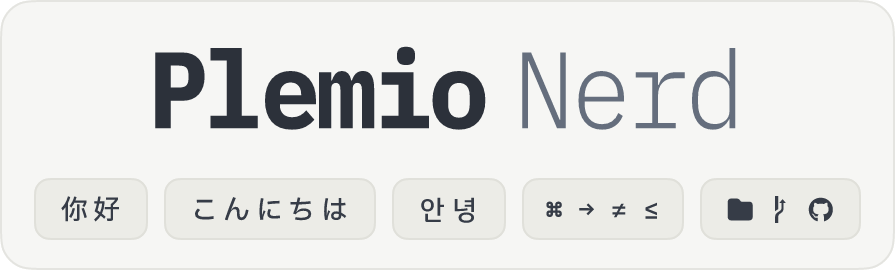
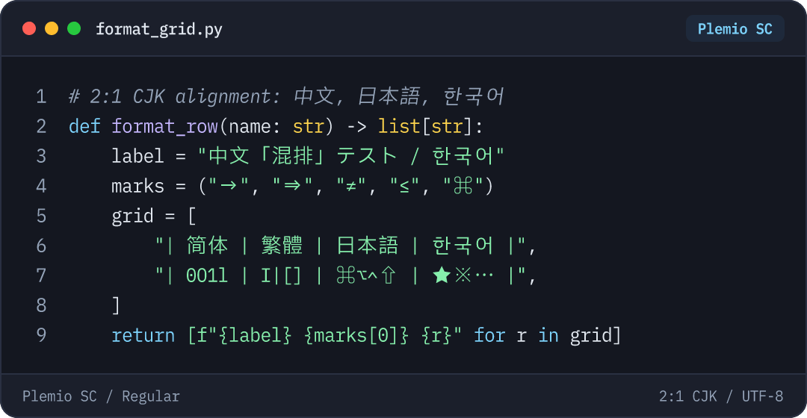
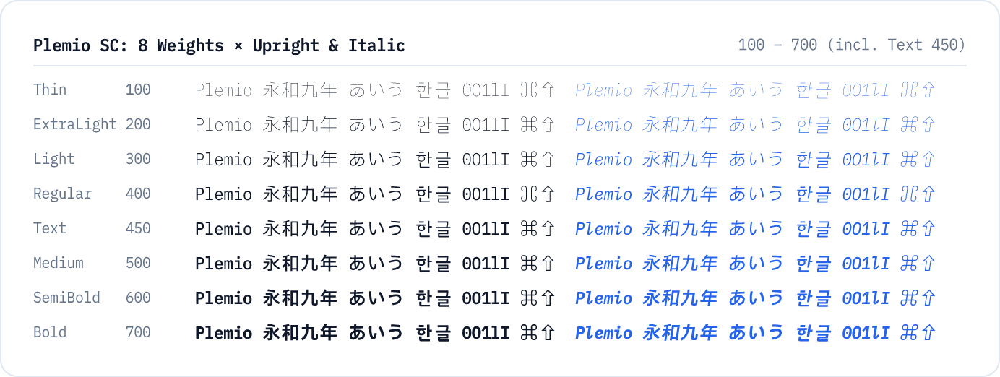
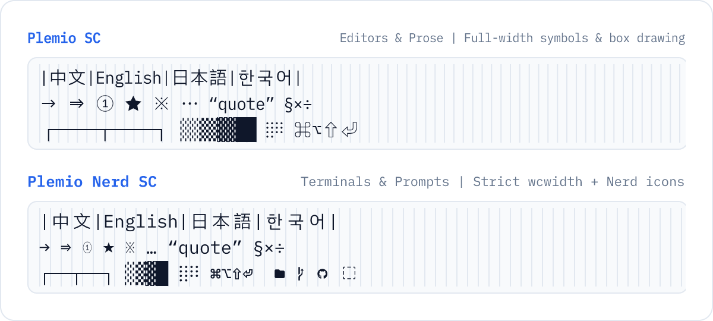
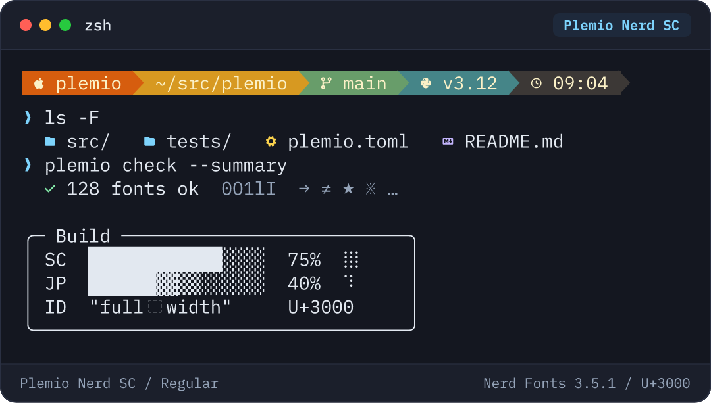
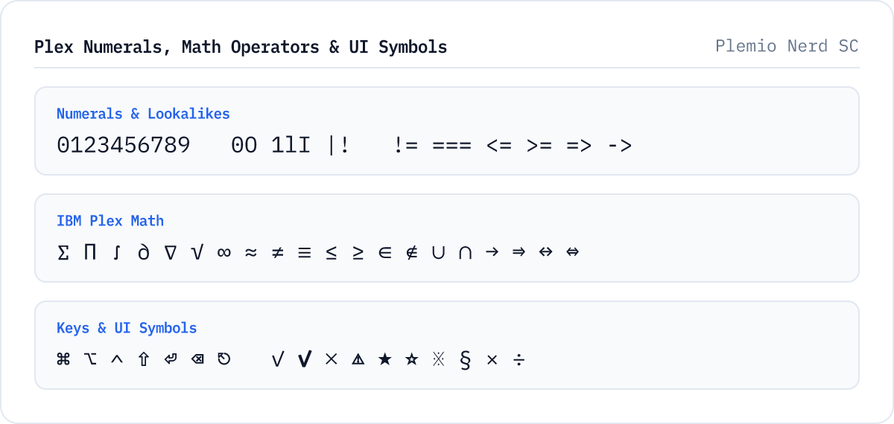

<div align="center">



[English](./README.md) | [简体中文](./README.zh-CN.md) | [繁體中文](./README.zh-TW.md) | [日本語](./README.ja.md) | [한국어](./README.ko.md)

[](./OFL.txt)
[](./LICENSE)

</div>

Plemio is a monospaced programming font built on IBM Plex for terminals, code editors, and technical writing. Chinese, Japanese, and Korean (CJK) characters are exactly twice as wide as Latin characters, so mixed-language code, comments, and tables stay aligned.

<p align="center">
  
</p>

## ✨ Features

### `1` Eight weights with italics

Eight weights run from `Thin` (100) to `Bold` (700), including IBM Plex's `Text` (450). Every weight has an italic, and its CJK glyphs slant at the same angle as IBM Plex Mono Italic.

<p align="center">
  
</p>

### `2` Two series: editors and terminals

- **Plemio** (editors and documents): slightly narrower Latin, with full-width CJK punctuation, arrows, and box drawing.
- **Plemio Nerd** (terminals): IBM Plex Mono at its original width, ambiguous-width symbols kept narrow as terminals expect, and Nerd Fonts icons built in.

<p align="center">
  
</p>

### `3` Terminal icons and symbols

**Plemio Nerd** includes Nerd Fonts icons, seamless Powerline separators, gap-free box drawing, braille patterns, and a dashed marker that makes ideographic spaces (`U+3000`) visible.

<p align="center">
  
</p>

### `4` Vertically balanced symbols

Plemio keeps IBM Plex Mono's distinct `0O` and `1lI`, and positions other glyphs so they sit level with Latin code:

- CJK characters align with the optical center of Latin text.
- Math operators such as `≠`, `≤`, `→`, and `∑` come from IBM Plex Math and share an axis with `=` and `+`.
- Arrows, macOS key symbols (`⌘`, `⌥`, `⇧`), and checkmarks center on the capital height.

<p align="center">
  
</p>

## 📦 Download & Install

### Homebrew

Install on macOS or Linux via [Homebrew](https://brew.sh/) (replace `sc` with `tc`, `jp`, or `kr` for another region):

```bash
brew install --cask fang2hou/tap/font-plemio-sc
brew install --cask fang2hou/tap/font-plemio-nerd-sc

# Or install all four regions bundled as TTC
brew install --cask fang2hou/tap/font-plemio
brew install --cask fang2hou/tap/font-plemio-nerd
```

### Direct download

Download an archive below, unzip it, and install the `.ttf` files. The four regional builds cover the same characters and differ only in regional glyph forms, so one is enough.

| Region | Plemio (Editors) | Plemio Nerd (Terminals) |
| :--- | :--- | :--- |
| Simplified Chinese (`SC`) | [Plemio-SC.zip](https://github.com/fang2hou/Plemio/releases/latest/download/Plemio-SC.zip) | [Plemio-Nerd-SC.zip](https://github.com/fang2hou/Plemio/releases/latest/download/Plemio-Nerd-SC.zip) |
| Traditional Chinese (`TC`) | [Plemio-TC.zip](https://github.com/fang2hou/Plemio/releases/latest/download/Plemio-TC.zip) | [Plemio-Nerd-TC.zip](https://github.com/fang2hou/Plemio/releases/latest/download/Plemio-Nerd-TC.zip) |
| Japanese (`JP`) | [Plemio-JP.zip](https://github.com/fang2hou/Plemio/releases/latest/download/Plemio-JP.zip) | [Plemio-Nerd-JP.zip](https://github.com/fang2hou/Plemio/releases/latest/download/Plemio-Nerd-JP.zip) |
| Korean (`KR`) | [Plemio-KR.zip](https://github.com/fang2hou/Plemio/releases/latest/download/Plemio-KR.zip) | [Plemio-Nerd-KR.zip](https://github.com/fang2hou/Plemio/releases/latest/download/Plemio-Nerd-KR.zip) |

`.ttc` bundles and earlier versions are on the [Releases](https://github.com/fang2hou/Plemio/releases) page.

## 🔤 Source Typefaces

- **IBM Plex Mono**: Latin, Greek, Cyrillic, and box drawing
- **IBM Plex Math**: math operators and arrows
- **IBM Plex Sans SC / TC / JP / KR**: CJK characters
- **Nerd Fonts**: icons in `Plemio Nerd`
- **Noto Sans Mono & JetBrains Mono**: remaining symbols

## 🛠️ Development

Building from source requires [mise](https://mise.jdx.dev/) on macOS or Linux.

```bash
mise install          # install the pinned toolchain
mise run setup        # install dependencies and git hooks
mise run fetch        # download the source fonts
mise run build        # build all fonts into build/fonts
mise run verify-fonts # check the built fonts
mise run bundle       # pack TTCs into build/ttc
```

See [DEVELOPMENT.md](./DEVELOPMENT.md) and [ARCHITECTURE.md](./ARCHITECTURE.md) for details.

## 🤝 Contributing

Issues and pull requests are welcome. See [CONTRIBUTING.md](./CONTRIBUTING.md).

## 🙏 Acknowledgments

- [PlemoCJK](https://github.com/nexustar/PlemoCJK) and [PlemolJP](https://github.com/yuru7/PlemolJP)
- [IBM Plex](https://github.com/IBM/plex)
- [Nerd Fonts](https://github.com/ryanoasis/nerd-fonts), [Noto](https://github.com/notofonts/latin-greek-cyrillic), and [JetBrains Mono](https://github.com/JetBrains/JetBrainsMono)

## 📄 License

- Fonts: [OFL-1.1](./OFL.txt) (Nerd Fonts icons: MIT)
- Build code: [MIT](./LICENSE)
