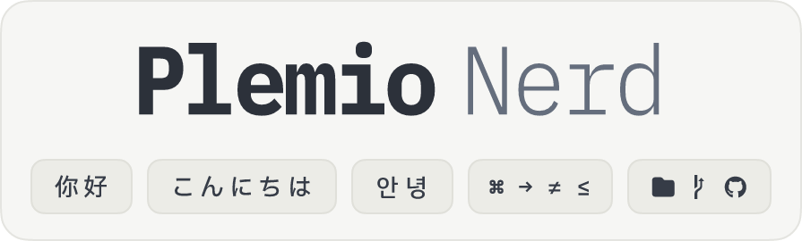
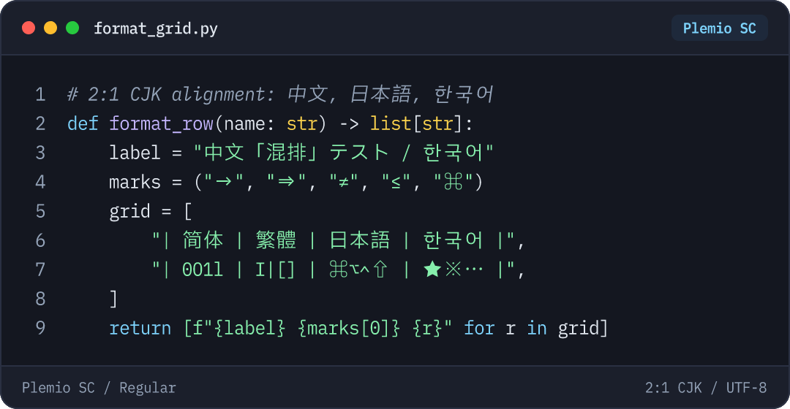
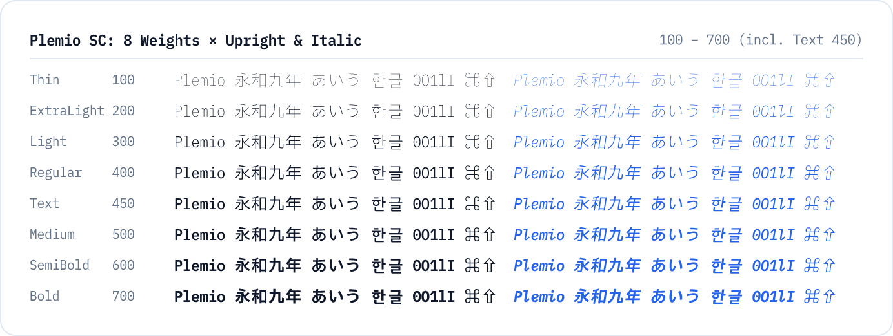
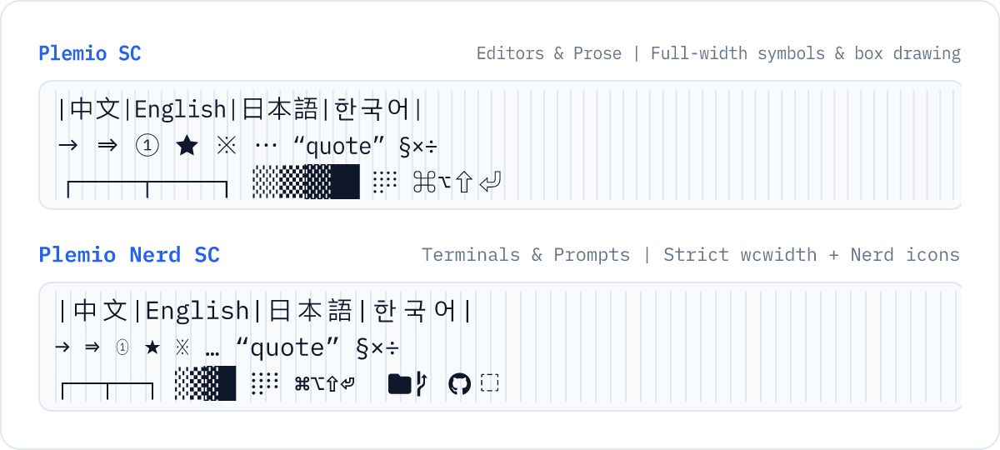
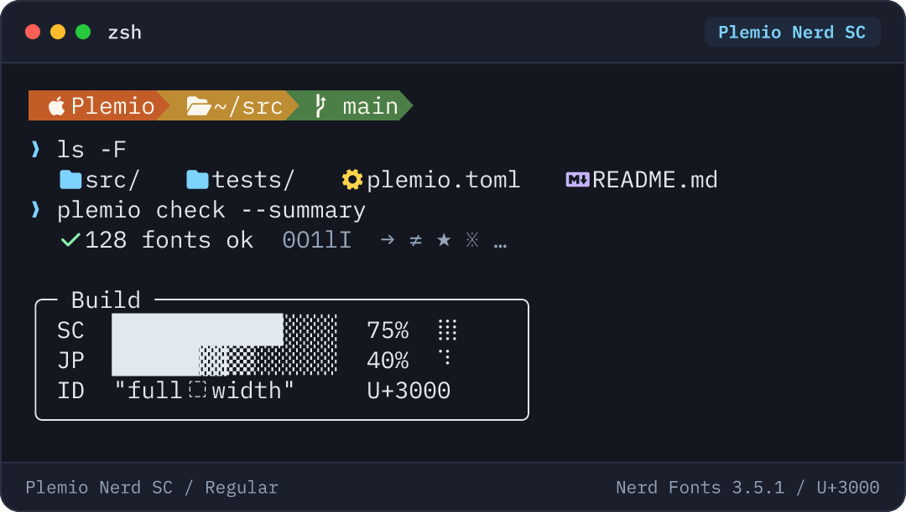
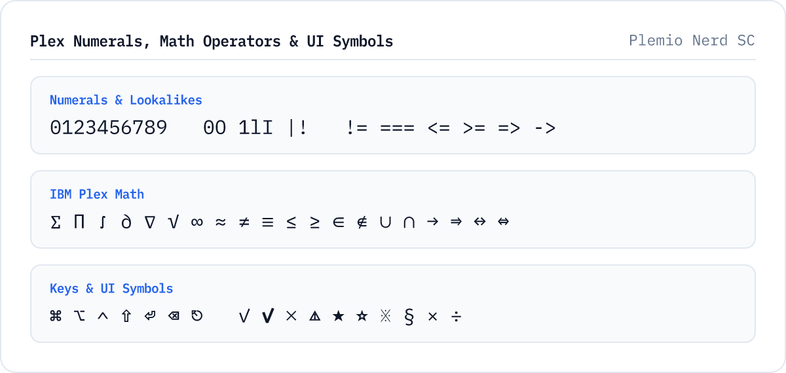

<div align="center">



[English](./README.md) | [简体中文](./README.zh-CN.md) | [繁體中文](./README.zh-TW.md) | [日本語](./README.ja.md) | [한국어](./README.ko.md)

[](./OFL.txt)
[](./LICENSE)

</div>

Plemio 是一款基于 IBM Plex 打造的等宽（Monospace）编程字体，适用于终端、代码编辑器和日常技术写作。字体中的中日韩（CJK）字符与英文字符严格保持 2:1 的宽度比例，混排代码、注释和表格时能够自然对齐。

<p align="center">

  

</p>

## ✨ 特性

### `1` 8 个字重与完整斜体

从 `Thin`（100）到 `Bold`（700）共 8 个字重，包含 IBM Plex 经典的 `Text`（450）字重，兼顾屏幕长时间阅读。每个字重都配有对应斜体，中日韩字形沿与 IBM Plex Mono Italic 相同的斜角倾斜。

<p align="center">

  

</p>

### `2` 2 个系列，适配不同使用场景

由于编辑器和终端对模糊宽度符号的处理方式不同，Plemio 提供了两个系列。**Plemio** 系列略微收窄了英文字符并保持中文标点、箭头和制表符为全角，适合编辑器与文档；**Plemio Nerd** 系列原样保留 IBM Plex Mono，严格遵循终端的 `wcwidth` 规则，让符号在终端里不重叠、不错位，并内置 Nerd Fonts 图标。

<p align="center">

  

</p>

### `3` 专为终端打造的 Nerd 图标与特殊符号

针对终端和命令行提示符，**Plemio Nerd** 完整内置 Nerd Fonts 图标与无缝 Powerline 分隔符，提供无断点的制表符、进度条方块、程序生成的盲文点阵，以及清晰可辨的全角空格（`U+3000`）虚线标记。

<p align="center">

  

</p>

### `4` 面向编程与终端的基线居中微调

简单的字体拼接往往会让中文、符号和图标与英文代码不在同一条视觉中线上。Plemio 在保留 IBM Plex Mono 清晰可辨的 `0O`、`1lI` 设计基础上，针对程序员高频使用的字符做了专门的基线与视觉居中微调，让混排代码在阅读字号下更齐整：

- **中日韩与英文混排居中**：对中文和日文字形做垂直微调，使汉字、假名与拉丁字母的视觉中心对齐；同时保留韩文字块的原生高度，并为全角括号补充水平偏移以减少多余留白。
- **数学与逻辑运算符对齐数学轴**：`≠`、`≤`、`≥`、`→`、`⇒`、`∈`、`∑` 等符号取自 IBM Plex Math，匹配各字重笔画粗细并对齐到与 `=`、`+`、`-` 相同的数学轴上。
- **日常编程与界面符号居中**：箭头、macOS 按键符号（`⌘`、`⌥`、`⌃`、`⇧`、`⏎`）、勾选标记和星号等图标类符号统一对齐大写字母高度的中线，不会在代码行内偏高或下沉。
- **终端图标与记号适配**：`Plemio Nerd` 中的 Nerd Fonts 图标、Powerline 分隔符、盲文进度点阵以及全角空格标记（`U+3000`）均按行盒高度重新居中，在不同终端模拟器中都能贴合文字基线显示。

<p align="center">

  

</p>

## 📦 下载与安装

点击下方对应版本的直链即可下载最新发布的独立压缩包，解压后安装其中的 `.ttf` 字体文件即可。四个地区版本（`SC`、`TC`、`JP`、`KR`）覆盖的字符完全相同，仅地区标准字形与标点位置有细微差异，按个人书写习惯任选其一即可。


| 地区 | Plemio（编辑器） | Plemio Nerd（终端） |
| :--- | :--- | :--- |
| 简体中文（`SC`） | [Plemio-SC.zip](https://github.com/fang2hou/Plemio/releases/latest/download/Plemio-SC.zip) | [Plemio-Nerd-SC.zip](https://github.com/fang2hou/Plemio/releases/latest/download/Plemio-Nerd-SC.zip) |
| 繁体中文（`TC`） | [Plemio-TC.zip](https://github.com/fang2hou/Plemio/releases/latest/download/Plemio-TC.zip) | [Plemio-Nerd-TC.zip](https://github.com/fang2hou/Plemio/releases/latest/download/Plemio-Nerd-TC.zip) |
| 日文（`JP`） | [Plemio-JP.zip](https://github.com/fang2hou/Plemio/releases/latest/download/Plemio-JP.zip) | [Plemio-Nerd-JP.zip](https://github.com/fang2hou/Plemio/releases/latest/download/Plemio-Nerd-JP.zip) |
| 韩文（`KR`） | [Plemio-KR.zip](https://github.com/fang2hou/Plemio/releases/latest/download/Plemio-KR.zip) | [Plemio-Nerd-KR.zip](https://github.com/fang2hou/Plemio/releases/latest/download/Plemio-Nerd-KR.zip) |


多地区打包的 `.ttc` 合集与历史版本可在 [Releases](https://github.com/fang2hou/Plemio/releases) 页面获取。

## 🚀 使用建议

- **代码编辑器与写作**：选用 `Plemio SC`（或 `TC`、`JP`、`KR`），可获得紧凑的英文节奏和全角中文标点。
- **终端与命令行提示符**：选用 `Plemio Nerd SC`（或 `TC`、`JP`、`KR`），可正常显示 Nerd Fonts 图标、Powerline 状态栏与全角空格标记，避免符号重叠。

<details>
<summary>在 xterm.js 终端中调整行高</summary>

Plemio 沿用 IBM Plex Mono 的 `1.3` 行高。基于 `xterm.js` 的终端（如 VS Code 内置终端、Orca）会在字体行高之上再乘以自身的行高配置：设为 `1.0` 保持字体默认行距；设为 `1.335` 可获得更舒展的纵向留白，并在 2 倍屏 `14 px` 下保持上下边距均匀。

</details>

## 🔤 字体构成

Plemio 由多款 IBM Plex 子字体与符号库组合而成：

- **IBM Plex Mono**：负责英文字符、数字、希腊/西里尔字母、基础标点与制表符
- **IBM Plex Math**：负责数学运算符、箭头与技术符号，并按各字重匹配笔画粗细
- **IBM Plex Sans SC / TC / JP / KR**：分别提供简体中文、繁体中文、日文假名汉字与韩文谚文
- **Nerd Fonts**：为 `Plemio Nerd` 系列提供开发者图标与 Powerline 分隔符
- **Noto Sans Mono 与 JetBrains Mono**：补齐其余少量生僻符号

## 🛠️ 本地构建

从源码构建需要在 macOS 或 Linux 上安装 [mise](https://mise.jdx.dev/)。所有工具版本已锁定在 `mise.toml` 中；执行 `mise run bundle` 打包 TTC 时需联网以通过 `pnpm dlx` 拉取打包工具。

```bash
mise install          # 安装 Python 3.12、uv、Node LTS、pnpm、prek、cocogitto、gitleaks
mise run setup        # 安装 Python 依赖与 git 钩子
mise run fetch        # 下载锁定版本的源字体并按 sources.lock 校验
mise run build        # 在 build/fonts 生成全部 128 个 TTF
mise run verify-fonts # 校验字宽、元数据与码位覆盖
mise run bundle       # 将各地区 TTF 打包为 build/ttc 下的 TTC 合集
```

参数微调与预览图生成说明见 [DEVELOPMENT.md](./DEVELOPMENT.md)，架构约束见 [ARCHITECTURE.md](./ARCHITECTURE.md)。

## 🤝 参与贡献

欢迎提交 Issue 或 Pull Request。提交前请先阅读 [CONTRIBUTING.md](./CONTRIBUTING.md)，了解分支流程、Conventional Commits 规范以及视觉改动的对比要求。

## 🙏 致谢

- **PlemoCJK 与 PlemolJP**：为本项目的双系列定位和四地区覆盖提供了设计灵感（[PlemoCJK](https://github.com/nexustar/PlemoCJK)、[PlemolJP](https://github.com/yuru7/PlemolJP)；Plemio 采用纯 Python 从零合成，不包含任何 PlemolJP 字体数据）。
- **IBM Plex**：提供核心的 Mono、Math 以及 Sans SC / TC / JP / KR 字体家族（[IBM/plex](https://github.com/IBM/plex)）。
- **Nerd Fonts、Noto Sans Mono 与 JetBrains Mono**：提供终端图标与补全符号（[nerd-fonts](https://github.com/ryanoasis/nerd-fonts)、[Noto](https://github.com/notofonts/latin-greek-cyrillic)、[JetBrainsMono](https://github.com/JetBrains/JetBrainsMono)）。
- **fontTools、skia-pathops、ttfautohint 与 otb-ttc-bundle**：支撑字形合成、笔画粗细调整、拉丁文 Hinting 重建与 TTC 打包。

## 📄 开源许可

- 字体文件：[OFL-1.1](./OFL.txt)（IBM Plex 保留了字体名称“Plex”，派生字体不可使用该名称；Nerd Fonts 图标采用 MIT 许可）
- 构建代码：[MIT](./LICENSE)