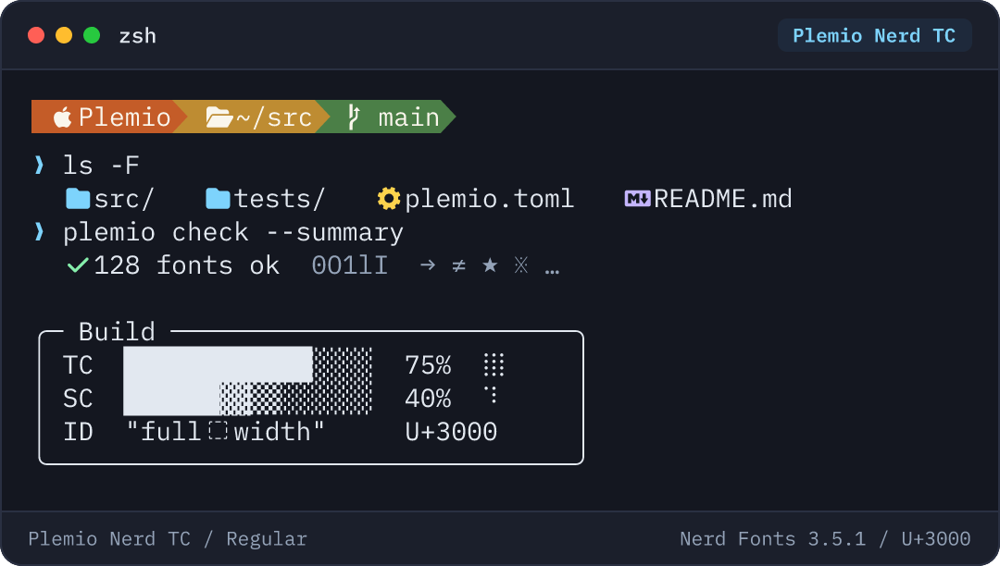

<div align="center">


[English](./README.md) | [简体中文](./README.zh-CN.md) | [繁體中文](./README.zh-TW.md) | [日本語](./README.ja.md) | [한국어](./README.ko.md)

[](./OFL.txt)
[](./LICENSE)

</div>

Plemio 是一款基於 IBM Plex 打造的等寬（Monospace）程式設計字型，適用於終端機、程式碼編輯器與日常技術寫作。中日韓（CJK）字元與英文字元嚴格維持 2:1 的寬度比例，混排程式碼、註解與表格時能夠自然對齊。

<p align="center">
  
</p>

## ✨ 特色

### `1` 8 個字重與完整斜體

從 `Thin`（100）到 `Bold`（700）共 8 個字重，包含 IBM Plex 經典的 `Text`（450）字重，兼顧長時間螢幕閱讀。每個字重皆配有對應斜體，中日韓字形沿著與 IBM Plex Mono Italic 相同的傾角傾斜。

<p align="center">
  
</p>

### `2` 2 個系列，對應不同使用情境

由於編輯器與終端機處理模糊寬度符號的方式不同，Plemio 提供兩個系列。**Plemio** 系列略微收窄拉丁字母，並讓中文標點、箭頭與框線字元保持全形，適合編輯器與文件寫作；**Plemio Nerd** 系列原樣保留 IBM Plex Mono，嚴格遵循終端機的 `wcwidth` 規則，避免符號重疊或錯位，並內建 Nerd Fonts 圖示。

<p align="center">
  
</p>

### `3` 專為終端機打造的 Nerd 圖示與特殊符號

針對終端機與命令列提示字元，**Plemio Nerd** 完整內建 Nerd Fonts 圖示與無縫 Powerline 分隔符，提供無斷點的框線字元、進度條方塊、程式生成的點字圖樣，以及清晰可辨的全形空白（`U+3000`）虛線標記。

<p align="center">
  
</p>

### `4` 面向程式設計與終端機的基線居中微調

單純的字型拼接常會讓漢字、符號與圖示跟英文程式碼不在同一條視覺中線上。Plemio 在保留 IBM Plex Mono 清晰易辨的 `0O`、`1lI` 設計基礎上，針對開發者常用的字元逐類微調基線與視覺中心，使混排程式碼在閱讀字號下依然齊整：

- **中日韓與英文混排居中**：微調中文與日文字形的垂直位置，使漢字、假名與拉丁字母的視覺中心對齊；同時保留韓文字塊的原生高度，並為全形括號加上水平偏移以減少多餘留白。
- **數學與邏輯運算子對齊數學軸**：`≠`、`≤`、`≥`、`→`、`⇒`、`∈`、`∑` 等符號取自 IBM Plex Math，依各字重匹配筆畫粗細，並對齊至與 `=`、`+`、`-` 相同的數學軸。
- **日常程式與介面符號居中**：箭頭、macOS 按鍵符號（`⌘`、`⌥`、`⌃`、`⇧`、`⏎`）、勾選符號與星號等圖示類字元統一對齊大寫字母高度的中線，不會在程式碼行內偏高或下沉。
- **終端機圖示與記號適配**：`Plemio Nerd` 中的 Nerd Fonts 圖示、Powerline 分隔符、點字進度圖樣與全形空白標記（`U+3000`）皆依行盒高度重新居中，在不同終端機模擬器中都能貼合文字基線顯示。

<p align="center">
  
</p>

## 📦 下載與安裝

點擊下方對應版本的連結即可下載最新發布的獨立壓縮檔，解壓縮後安裝裡面的 `.ttf` 字型檔即可。四個地區版本（`SC`、`TC`、`JP`、`KR`）收錄的字元完全相同，僅在地區標準字形與標點位置有所差異，依個人書寫習慣擇一安裝即可。

| 地區 | Plemio（編輯器） | Plemio Nerd（終端機） |
| :--- | :--- | :--- |
| 簡體中文（`SC`） | [Plemio-SC.zip](https://github.com/fang2hou/Plemio/releases/latest/download/Plemio-SC.zip) | [Plemio-Nerd-SC.zip](https://github.com/fang2hou/Plemio/releases/latest/download/Plemio-Nerd-SC.zip) |
| 繁體中文（`TC`） | [Plemio-TC.zip](https://github.com/fang2hou/Plemio/releases/latest/download/Plemio-TC.zip) | [Plemio-Nerd-TC.zip](https://github.com/fang2hou/Plemio/releases/latest/download/Plemio-Nerd-TC.zip) |
| 日文（`JP`） | [Plemio-JP.zip](https://github.com/fang2hou/Plemio/releases/latest/download/Plemio-JP.zip) | [Plemio-Nerd-JP.zip](https://github.com/fang2hou/Plemio/releases/latest/download/Plemio-Nerd-JP.zip) |
| 韓文（`KR`） | [Plemio-KR.zip](https://github.com/fang2hou/Plemio/releases/latest/download/Plemio-KR.zip) | [Plemio-Nerd-KR.zip](https://github.com/fang2hou/Plemio/releases/latest/download/Plemio-Nerd-KR.zip) |

多地區封裝的 `.ttc` 合集與歷史版本可至 [Releases](https://github.com/fang2hou/Plemio/releases) 頁面下載。

## 🚀 使用建議

- **程式碼編輯器與寫作**：選用 `Plemio TC`（或 `SC`、`JP`、`KR`），可獲得緊湊的英文節奏與全形中文標點。
- **終端機與命令列提示字元**：選用 `Plemio Nerd TC`（或 `SC`、`JP`、`KR`），可正常顯示 Nerd Fonts 圖示、Powerline 狀態列與全形空白標記，避免符號重疊。

<details>
<summary>在 xterm.js 終端機中調整行高</summary>

Plemio 沿用 IBM Plex Mono 的 `1.3` 行高。基於 `xterm.js` 的終端機（如 VS Code 內建終端機、Orca）會在字型行高之上再乘以自身的行高設定：設為 `1.0` 可維持字型預設行距；設為 `1.335` 則能增加縱向留白，並在 2 倍解析度螢幕 `14 px` 下保持上下邊距均勻。

</details>

## 🔤 字型構成

Plemio 由多款 IBM Plex 子字型與符號庫組合而成：

- **IBM Plex Mono**：負責英文字元、數字、希臘與西里爾字母、基礎標點與框線字元
- **IBM Plex Math**：負責數學運算子、箭頭與技術符號，並依各字重匹配筆畫粗細
- **IBM Plex Sans SC / TC / JP / KR**：分別提供簡體中文、繁體中文、日文假名漢字與韓文諺文
- **Nerd Fonts**：為 `Plemio Nerd` 系列提供開發者圖示與 Powerline 分隔符
- **Noto Sans Mono 與 JetBrains Mono**：補齊其餘少量生僻符號

## 🛠️ 本機建置

從原始碼建置需在 macOS 或 Linux 上安裝 [mise](https://mise.jdx.dev/)。所有工具版本皆已鎖定於 `mise.toml`；執行 `mise run bundle` 封裝 TTC 時需連網透過 `pnpm dlx` 取得打包工具。

```bash
mise install          # 安裝 Python 3.12、uv、Node LTS、pnpm、prek、cocogitto、gitleaks
mise run setup        # 安裝 Python 相依套件與 Git Hook
mise run fetch        # 下載鎖定版本的上游字型並依 sources.lock 驗證
mise run build        # 在 build/fonts 產生全部 128 個 TTF
mise run verify-fonts # 驗證字寬、中繼資料與碼位覆蓋
mise run bundle       # 將各地區 TTF 封裝為 build/ttc 下的 TTC 合集
```

參數微調與預覽圖產生說明請見 [DEVELOPMENT.md](./DEVELOPMENT.md)，架構約束請見 [ARCHITECTURE.md](./ARCHITECTURE.md)。

## 🤝 參與貢獻

歡迎提交 Issue 或 Pull Request。提交前請先閱讀 [CONTRIBUTING.md](./CONTRIBUTING.md)，了解分支流程、Conventional Commits 規範與視覺變更的對比要求。

## 🙏 致謝

- **PlemoCJK 與 PlemolJP**：為本專案的雙系列定位與四地區覆蓋提供設計靈感（[PlemoCJK](https://github.com/nexustar/PlemoCJK)、[PlemolJP](https://github.com/yuru7/PlemolJP)；Plemio 採用純 Python 從零合成，不包含任何 PlemolJP 字型資料）。
- **IBM Plex**：提供核心的 Mono、Math 以及 Sans SC / TC / JP / KR 字型家族（[IBM/plex](https://github.com/IBM/plex)）。
- **Nerd Fonts、Noto Sans Mono 與 JetBrains Mono**：提供終端機圖示與補全符號（[nerd-fonts](https://github.com/ryanoasis/nerd-fonts)、[Noto](https://github.com/notofonts/latin-greek-cyrillic)、[JetBrainsMono](https://github.com/JetBrains/JetBrainsMono)）。
- **fontTools、skia-pathops、ttfautohint 與 otb-ttc-bundle**：支撐字形合成、筆畫粗細調整、拉丁文 Hinting 重建與 TTC 封裝。

## 📄 授權條款

- 字型檔案：[OFL-1.1](./OFL.txt)（IBM Plex 保留字型名稱「Plex」，衍生字型不得使用該名稱；Nerd Fonts 圖示採 MIT 授權）
- 建置程式碼：[MIT](./LICENSE)
