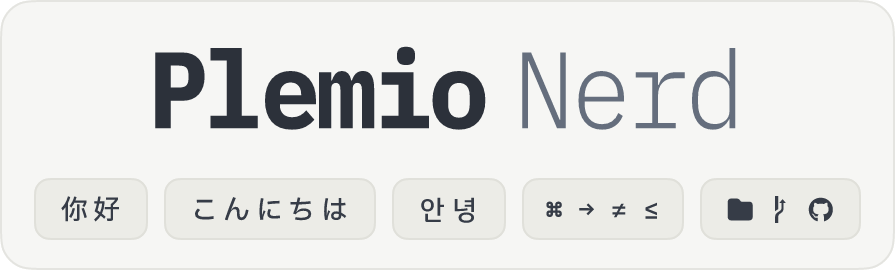
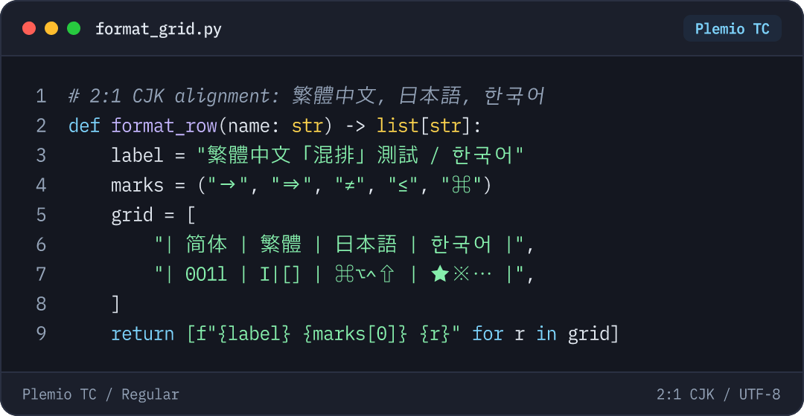
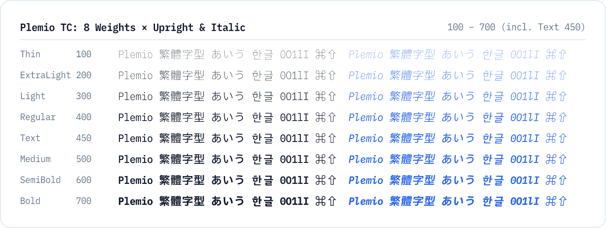
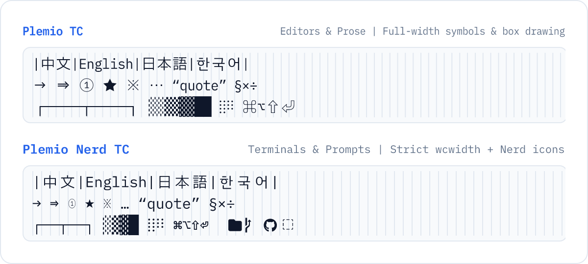
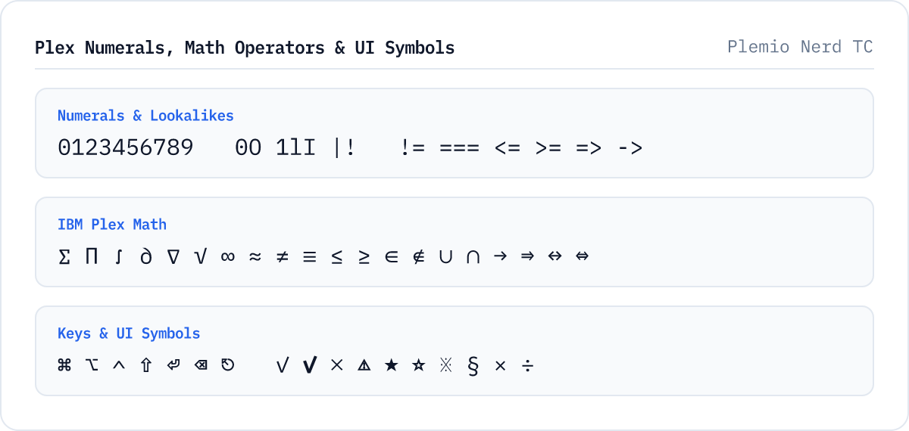

<div align="center">



[English](./README.md) | [简体中文](./README.zh-CN.md) | [繁體中文](./README.zh-TW.md) | [日本語](./README.ja.md) | [한국어](./README.ko.md)

[](./OFL.txt)
[](./LICENSE)

</div>

Plemio 是一款基於 IBM Plex 的等寬程式設計字型，適用於終端機、程式碼編輯器與技術寫作。中日韓（CJK）字元的寬度嚴格等於英文字元的兩倍，中英混排的程式碼、註解與表格都能對齊。

<p align="center">
  
</p>

## ✨ 特色

### `1` 8 個字重與斜體

從 `Thin`（100）到 `Bold`（700）共 8 個字重，包含 IBM Plex 的 `Text`（450）。每個字重皆有斜體，中日韓字形與 IBM Plex Mono Italic 傾斜角度一致。

<p align="center">
  
</p>

### `2` 編輯器與終端機兩個系列

- **Plemio**（編輯器與文件）：拉丁字母略微收窄，中文標點、箭頭與框線字元保持全形。
- **Plemio Nerd**（終端機）：保留 IBM Plex Mono 原始字寬，模糊寬度符號依終端機慣例取半形，並內建 Nerd Fonts 圖示。

<p align="center">
  
</p>

### `3` 終端機圖示與符號

**Plemio Nerd** 內建 Nerd Fonts 圖示、無縫 Powerline 分隔符、無斷點框線字元與點字圖樣，並以虛線標出全形空白（`U+3000`）。

<p align="center">
  
</p>

### `4` 符號垂直置中

Plemio 保留 IBM Plex Mono 易於辨識的 `0O` 與 `1lI`，並調整其他字形的高度，使其與英文程式碼對齊：

- 中日韓字元與英文的視覺中心對齊。
- `≠`、`≤`、`→`、`∑` 等數學符號取自 IBM Plex Math，與 `=`、`+` 位於同一軸線。
- 箭頭、macOS 按鍵符號（`⌘`、`⌥`、`⇧`）與勾選符號對齊大寫字母高度的中線。

<p align="center">
  
</p>

## 📦 下載與安裝

### Homebrew

在 macOS 或 Linux 上可透過 [Homebrew](https://brew.sh/) 直接安裝（如需其他地區版本，將 `tc` 改為 `sc`、`jp` 或 `kr`）：

```bash
brew install --cask fang2hou/tap/font-plemio-tc
brew install --cask fang2hou/tap/font-plemio-nerd-tc

# 或安裝包含四地區的 TTC 合集
brew install --cask fang2hou/tap/font-plemio
brew install --cask fang2hou/tap/font-plemio-nerd
```

### 手動下載

下載下方的壓縮檔，解壓縮後安裝其中的 `.ttf` 檔案。四個地區版本收錄的字元相同，只有地區字形不同，擇一即可。

| 地區 | Plemio（編輯器） | Plemio Nerd（終端機） |
| :--- | :--- | :--- |
| 簡體中文（`SC`） | [Plemio-SC.zip](https://github.com/fang2hou/Plemio/releases/latest/download/Plemio-SC.zip) | [Plemio-Nerd-SC.zip](https://github.com/fang2hou/Plemio/releases/latest/download/Plemio-Nerd-SC.zip) |
| 繁體中文（`TC`） | [Plemio-TC.zip](https://github.com/fang2hou/Plemio/releases/latest/download/Plemio-TC.zip) | [Plemio-Nerd-TC.zip](https://github.com/fang2hou/Plemio/releases/latest/download/Plemio-Nerd-TC.zip) |
| 日文（`JP`） | [Plemio-JP.zip](https://github.com/fang2hou/Plemio/releases/latest/download/Plemio-JP.zip) | [Plemio-Nerd-JP.zip](https://github.com/fang2hou/Plemio/releases/latest/download/Plemio-Nerd-JP.zip) |
| 韓文（`KR`） | [Plemio-KR.zip](https://github.com/fang2hou/Plemio/releases/latest/download/Plemio-KR.zip) | [Plemio-Nerd-KR.zip](https://github.com/fang2hou/Plemio/releases/latest/download/Plemio-Nerd-KR.zip) |

`.ttc` 合集與歷史版本請見 [Releases](https://github.com/fang2hou/Plemio/releases) 頁面。

## 🔤 字型構成

- **IBM Plex Mono**：英文、希臘字母、西里爾字母與框線字元
- **IBM Plex Math**：數學運算子與箭頭
- **IBM Plex Sans SC / TC / JP / KR**：中日韓字元
- **Nerd Fonts**：`Plemio Nerd` 中的圖示
- **Noto Sans Mono 與 JetBrains Mono**：其餘符號

## 🛠️ 本機建置

從原始碼建置需在 macOS 或 Linux 上安裝 [mise](https://mise.jdx.dev/)。

```bash
mise install          # 安裝鎖定版本的工具鏈
mise run setup        # 安裝相依套件與 Git Hook
mise run fetch        # 下載來源字型
mise run build        # 在 build/fonts 產生全部字型
mise run verify-fonts # 驗證產生的字型
mise run bundle       # 在 build/ttc 封裝 TTC
```

詳見 [DEVELOPMENT.md](./DEVELOPMENT.md) 與 [ARCHITECTURE.md](./ARCHITECTURE.md)。

## 🤝 參與貢獻

歡迎提交 Issue 或 Pull Request，請先閱讀 [CONTRIBUTING.md](./CONTRIBUTING.md)。

## 🙏 致謝

- [PlemoCJK](https://github.com/nexustar/PlemoCJK) 與 [PlemolJP](https://github.com/yuru7/PlemolJP)
- [IBM Plex](https://github.com/IBM/plex)
- [Nerd Fonts](https://github.com/ryanoasis/nerd-fonts)、[Noto](https://github.com/notofonts/latin-greek-cyrillic) 與 [JetBrains Mono](https://github.com/JetBrains/JetBrainsMono)

## 📄 授權條款

- 字型檔案：[OFL-1.1](./OFL.txt)（Nerd Fonts 圖示採 MIT 授權）
- 建置程式碼：[MIT](./LICENSE)
